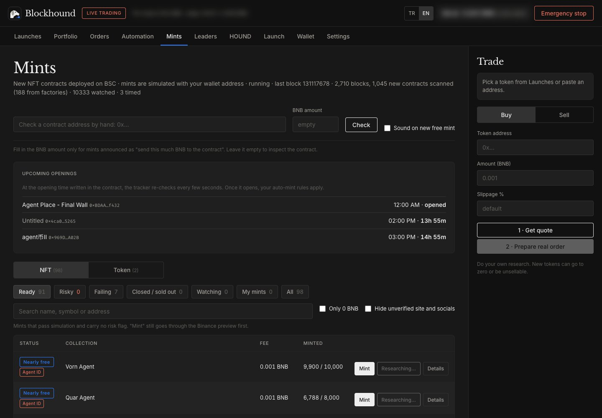
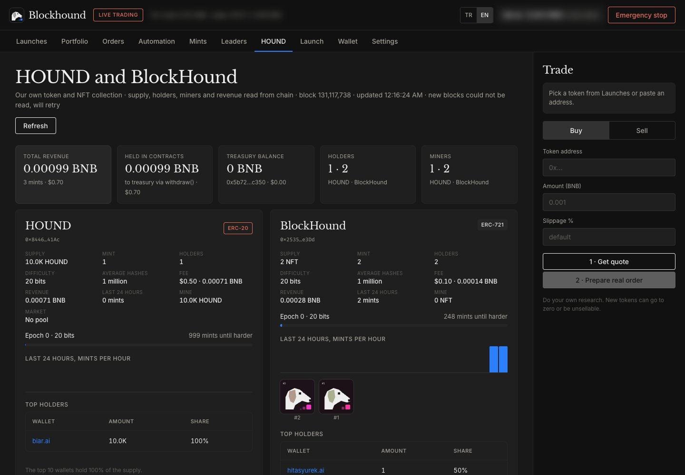
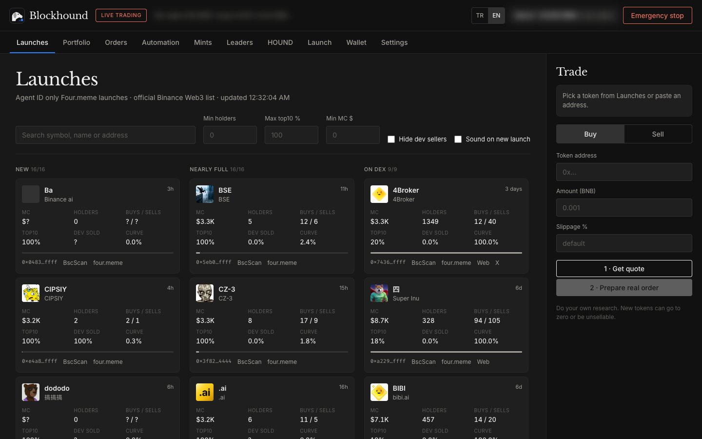
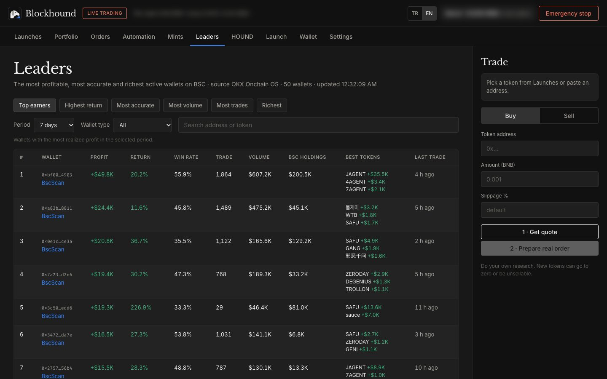
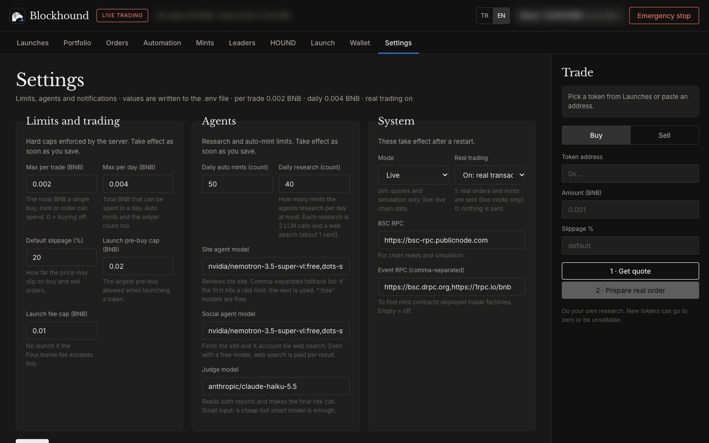

<p align="center"></p>

<h1 align="center">Blockhound</h1>

<p align="center">A local, open-source agent terminal for BNB Chain that sniffs out new mints from the first block.<br>
<a href="https://blockhound.pages.dev">Website</a> · <a href="https://blockhound.pages.dev/mint.html">HOUND mint</a> · <a href="README.tr.md">Türkçe</a></p>

> **Warning.** With live trading on, this software spends real money and transactions cannot be undone. Most free mints are worth
> nothing and new tokens can go to zero or never become sellable. The code has not been audited. Nothing here is investment advice.

Blockhound runs on your own computer and talks to your wallet through the official
[Binance Agentic Wallet](https://www.binance.com/) CLI (`baw`). Your private key never touches this program: every signature happens
on Binance's side, and the server only listens on `127.0.0.1`.

The interface is available in English and Turkish (switch with the TR / EN buttons in the top bar). The source code is in Turkish; issues and pull requests in English are welcome.

<p align="center"></p>

## A quick tour

Screenshots from the real terminal with live chain data. The wallet balance and address are blurred.

| | |
| --- | --- |
| **Mints (Mintler).** Every new contract is simulated with your wallet and sorted into ready, risky, failing and closed. NFT and token mints have separate tabs; Agent ID gated mints carry a badge. |  |
| **HOUND.** Live supply, holders, miners, revenue and the current difficulty of the project's own token and NFT collection. |  |
| **Launches (Siper).** Agent ID launches on Four.meme in three columns: new, nearly full and graduated to DEX. |  |
| **Leaders (Liderler).** Top BSC wallets by profit, accuracy and activity, with the tokens that earned them the most. |  |
| **Settings (Ayarlar).** Per-trade and daily BNB caps, the auto-mint limit, AI models and RPC endpoints, all from the UI. |  |

## What it does

- **Mint tracking (Mintler).** Scans every new block for contract deployments, including contracts created inside factory
  contracts, proxies and Agent ID gated mints. Simulates each mint function with your wallet address, reads the fee, supply and
  eligibility, and recognizes both NFT mints and token mints distributed through a mint contract.
- **Free safety filter.** Before anything is sent: OKX transaction, token and site scans, impersonated brand names, and the Binance
  wallet preview as the last gate. Anything that asks for a token approval, changes authority, causes an unexpected outflow or
  delivers nothing to the wallet is dropped.
- **Auto-mint.** Only gas-only (0 BNB) mints that pass your rules are sent automatically, within a daily cap. Anything that asks
  for BNB, even 0.001, is shown to you with a one-click mint flow and waits for your approval.
- **Upcoming openings.** Contracts that publish an opening time (startTime, openAt and similar) get a countdown. From 5 seconds
  before the opening the tracker re-checks them every 1.5 seconds, so a free phase is caught in its first seconds.
- **Market-open alerts.** Tokens you hold without a price (pools not created yet) are checked periodically; you get a desktop
  notification the moment a market opens.
- **Portfolio.** Real profit and loss from your wallet history, split into *Normal* and *Agent* (auto-minted) views, with charts,
  instant sell and price orders (take profit on Binance or locally, stop loss locally).
- **Launches (Siper).** Agent ID launches on Four.meme with filters, plus an optional sniper and auto-sell.
- **Leaders.** Top BSC wallets by PnL, win rate and volume (optional, via the OKX Onchain OS CLI).
- **Optional AI research.** Free OpenRouter models research the mint site and socials, a small paid "judge" model removes
  unfounded claims. Off by default; the rule-based filter works without it.
- **Settings.** Limits, agent caps, notification preferences and quiet hours, all from the UI.
- **HOUND tracking.** Supply, holders, miners, revenue, difficulty and recent mints of the project's own HOUND token and
  BlockHound NFTs, read from chain events.

## Safety model

- Private keys never live in this program. Wallet access goes through `baw`; signatures happen on Binance's side.
- The server binds to `127.0.0.1` only. Every state-changing request needs a local API token.
- Default mode is **simulation**: quotes only, no orders.
- Per-trade and daily BNB limits are enforced on the server and cannot be exceeded from the UI. Raising a limit or switching on
  live trading asks for a separate confirmation.
- Every contract call is previewed first. A risk warning, an authority change, an unexpected approval or outflow, or a call that
  brings nothing into the wallet stops the transaction.
- Content from websites, metadata and search results is treated as untrusted data, never as instructions.

## Requirements

- Node.js 20 or newer.
- [Binance Agentic Wallet CLI](https://www.npmjs.com/package/@binance/agentic-wallet) (`baw`), signed in with the Binance app.
  Contract calls (minting) need **Developer Mode** on in the Binance app: Agentic Wallet, Settings.
- Optional: [OKX Onchain OS CLI](https://web3.okx.com/) (`onchainos`) for the free safety scans and the Leaders tab.
  Without it the filter notes that the scan was skipped and relies on the Binance preview.
- Optional: an [OpenRouter](https://openrouter.ai/) key for AI research and a [Brave Search API](https://api-dashboard.search.brave.com/)
  key for free web search. Both can be entered from the UI.

## Install

```bash
git clone https://github.com/justbiar/blockhound.git
```

```bash
cd blockhound
```

```bash
npm install
```

```bash
npm i -g @binance/agentic-wallet
```

```bash
cp .env.example .env
```

```bash
npm start
```

Open `http://127.0.0.1:8787`. If the wallet is not connected, go to the **Cüzdan** (wallet) tab and press **QR ile bağlan**
(connect with QR): a QR code and pairing code appear on the page; scan and approve them in the Binance app.

On macOS, `scripts/baslat.sh` starts the server in the background and opens the browser, and `scripts/durdur.sh` stops it.

## Going live

Set both values in `.env` (or from the Settings tab) and restart:

```
MOD=live
CANLI_ISLEM=1
```

Start with low limits (`ISLEM_BASI_MAX_BNB`, `GUNLUK_MAX_BNB`) and small amounts. Every setting in `.env.example` is documented
inline.

## Project layout

| Path | What |
| --- | --- |
| `src/server.js` | Local HTTP server and API routes |
| `src/mintTakip.js`, `src/tokenMint.js` | Block scanning, mint detection and simulation |
| `src/suzgec.js`, `src/guard.js` | Safety filter and preview checks |
| `src/ajanlar.js`, `src/mintIslem.js` | Decisions, auto-mint and the mint flow |
| `src/pnl.js`, `src/portfoyServisi.js` | Portfolio and profit and loss |
| `public/` | The terminal UI (vanilla HTML, CSS, JS) |
| `site/` | The static introduction site and the HOUND mint page (`site/mint.html`) |
| `contracts/` | HOUND and BlockHound proof-of-work contracts (Foundry) |
| `src/houndTakip.js` | HOUND and BlockHound tracking (supply, holders, miners) |
| `test/` | Node test runner tests |

## HOUND and BlockHound

`contracts/` holds two proof-of-work mint contracts: the HOUND community token (10,000 per mint, 0.50 dollars) and the
BlockHound NFT collection (0.10 dollars, on-chain art). Both are live on BNB Smart Chain with verified source:
HOUND [`0x8446C862f84B948fDDAf1Be42c6B59ceCf5941Ac`](https://bscscan.com/address/0x8446C862f84B948fDDAf1Be42c6B59ceCf5941Ac#code),
BlockHound [`0x2535E83109909c7B9eA22D5b2f7c8621E595e3Dd`](https://bscscan.com/address/0x2535E83109909c7B9eA22D5b2f7c8621E595e3Dd#code).

How to mint: open the [mint page](https://blockhound.pages.dev/mint.html) (or `site/mint.html` locally), type your Agent ID name, let the browser find the hash, then send the two `baw` commands it
gives you from your agent wallet. The page also has a ready-made prompt for an AI agent with `baw` access and a chart of how the
difficulty grows. Supply is unlimited, but difficulty rises one bit per epoch, so minting
gets twice as hard each time. Anyone can search for the hash, but only wallets with a Binance Agent ID can mint. The mint page is `site/mint.html`; `npm run hound:madenci` is a command-line miner that prints
the baw commands to send and never touches a key. Details in [contracts/README.md](contracts/README.md) (Turkish).

## Tests

```bash
npm test
```

## Contributing

See [CONTRIBUTING.md](CONTRIBUTING.md). Security issues: see [SECURITY.md](SECURITY.md).

## Credits

[TMTN](https://github.com/bnbxcs/TMTN) (MIT) was studied for design ideas. Blockhound was written from scratch.

## License

[MIT](LICENSE). Blockhound is an independent project with no affiliation to Binance, OKX, Four.meme or any other organization.
