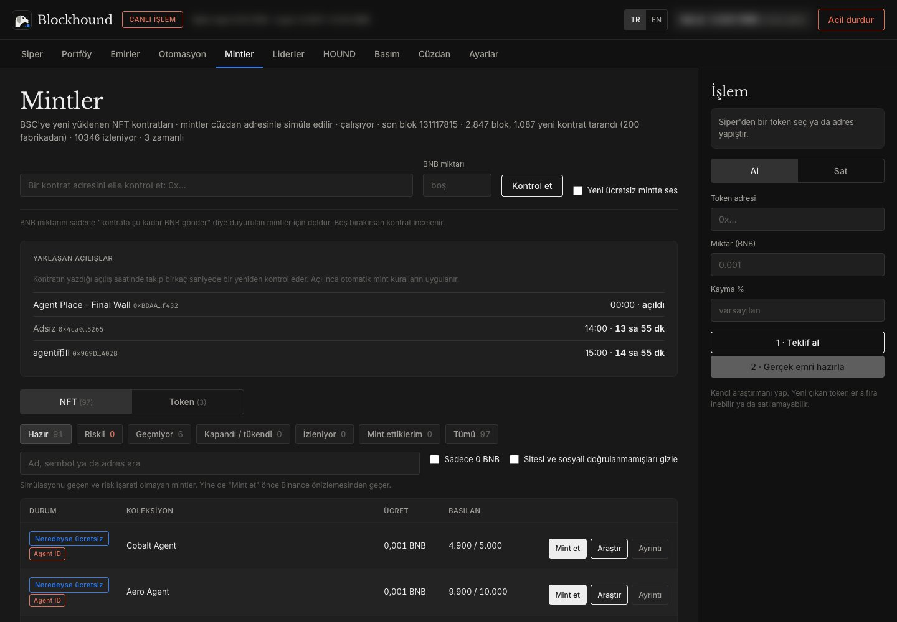
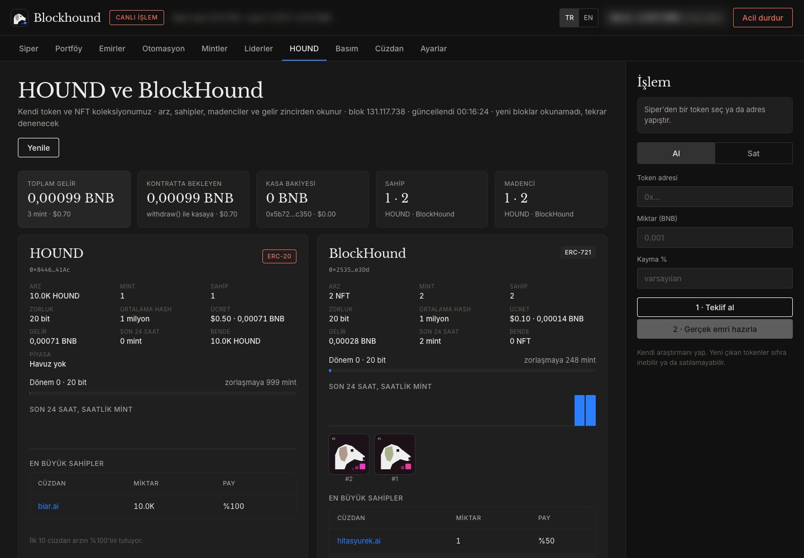
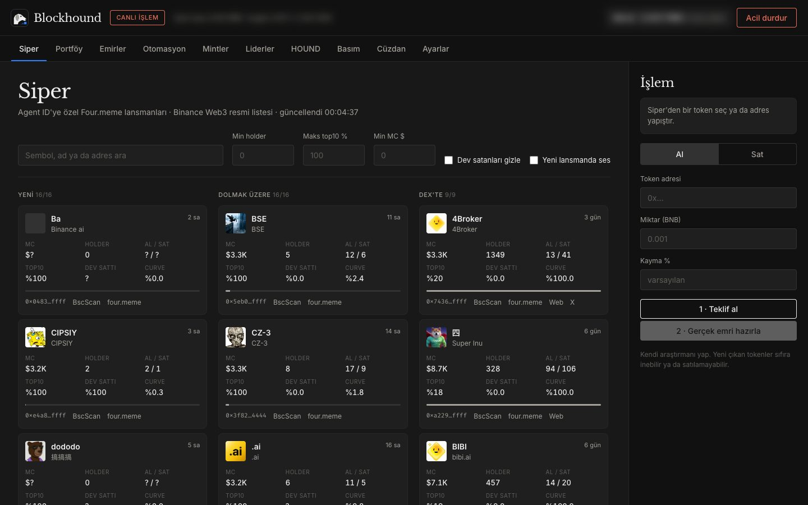
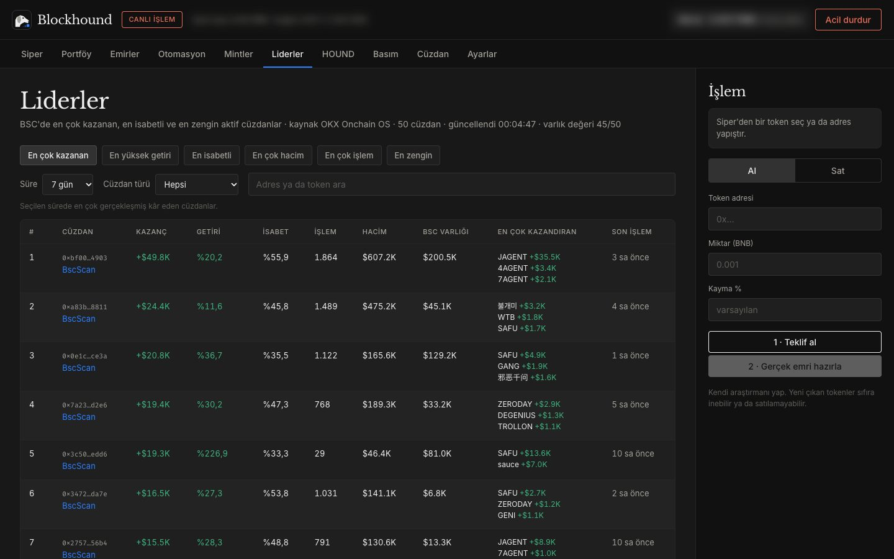
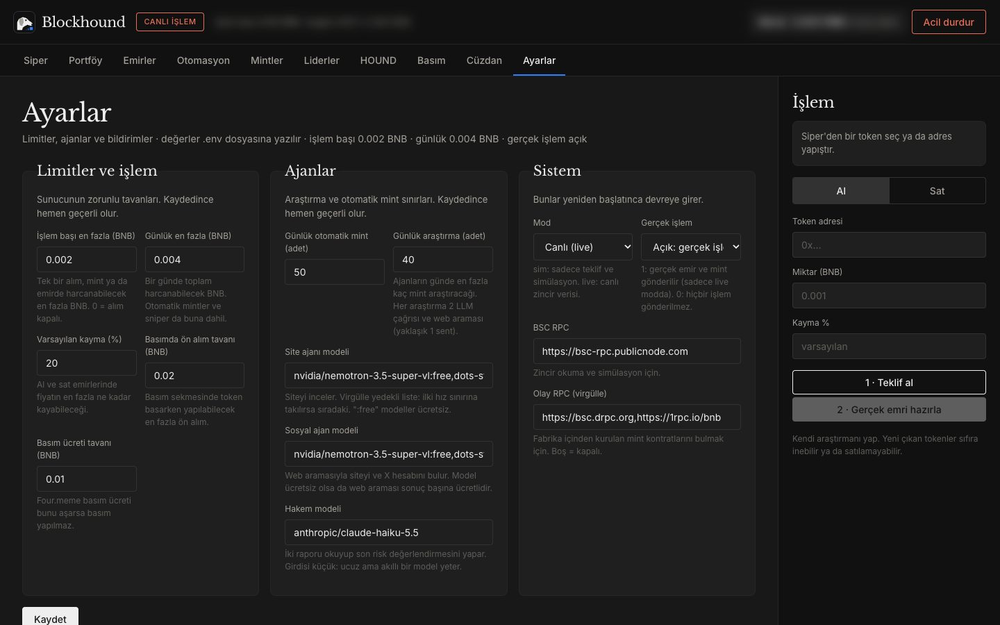

<p align="center"></p>

<h1 align="center">Blockhound</h1>

<p align="center">BNB Chain için yeni mintleri ilk bloktan koklayan, yerelde çalışan, açık kaynaklı bir ajan terminali.<br>
<a href="https://blockhound.pages.dev">Web sitesi</a> · <a href="https://blockhound.pages.dev/mint.html">HOUND mint</a> · <a href="README.md">English</a></p>

> **Uyarı.** Canlı işlem açıkken bu yazılım gerçek para harcar ve işlemler geri alınamaz. Ücretsiz mintlerin çoğunun değeri
> sıfırdır, yeni tokenler sıfıra inebilir ya da hiç satılamayabilir. Kod denetlenmemiştir. Yatırım tavsiyesi değildir.

Blockhound senin bilgisayarında çalışır ve cüzdanına resmi [Binance Agentic Wallet](https://www.binance.com/) CLI'ı (`baw`)
üzerinden bağlanır. Private key bu programa hiç girmez: her imza Binance tarafında atılır, sunucu sadece `127.0.0.1` adresini dinler.

<p align="center"></p>

## Kısa bir tur

Görüntüler gerçek terminalden, canlı zincir verisiyle alındı. Arayüz Türkçe, İngilizce ve Çince kullanılabilir (üst çubuktaki TR / EN / 中文 düğmeleri). Cüzdan bakiyesi ve adresi bulanıklaştırıldı.

| | |
| --- | --- |
| **Mintler.** Her yeni kontrat cüzdanınla simüle edilir; hazır, riskli, geçmiyor ve tükendi diye ayrılır. NFT ve token mintleri ayrı sekmelerde, Agent ID şartlı olanlar rozetle işaretli. |  |
| **HOUND.** Projenin kendi token ve NFT koleksiyonu için canlı arz, sahipler, madenciler, gelir ve mevcut zorluk. |  |
| **Siper.** Four.meme'deki Agent ID lansmanları üç sütunda: yeni, dolmak üzere ve DEX'e geçenler. |  |
| **Liderler.** BSC'de en çok kazanan, en isabetli ve en aktif cüzdanlar, en çok kazandıran tokenleriyle. |  |
| **Ayarlar.** İşlem başı ve günlük BNB tavanları, otomatik mint sınırı, yapay zekâ modelleri ve RPC adresleri arayüzden. |  |

## Ne yapar?

- **Mint takibi (Mintler).** Her yeni bloktaki kontrat kurulumlarını tarar. Fabrika kontratlarının içinden kurulanları, proxy
  kontratları ve Agent ID şartlı mintleri de yakalar. Mint fonksiyonlarını cüzdan adresinle simüle eder; ücreti, arzı ve hakkını
  zincirden okur. Hem NFT mintlerini hem de bir mint kontratı üzerinden dağıtılan token mintlerini tanır.
- **Ücretsiz güvenlik süzgeci.** Gönderimden önce OKX işlem, token ve site taramaları, taklit marka adları ve son kapı olarak Binance
  cüzdan önizlemesi. Token izni isteyen, yetki değiştiren, beklenmeyen çıkış yapan ya da cüzdana bir şey getirmeyen her şey elenir.
- **Otomatik mint.** Sadece gas ödenen (0 BNB) ve kuralları geçen mintler günlük sınır içinde otomatik gönderilir. 0.001 BNB bile
  isteyen her mint tek tıkla mint akışıyla sana gösterilir ve onayını bekler.
- **Yaklaşan açılışlar.** Açılış saatini yazan kontratlar (startTime, openAt vb.) geri sayımla gösterilir. Açılıştan 5 saniye
  önce başlayıp 1,5 saniyede bir yeniden kontrol edilir, böylece bedava faz ilk saniyelerde yakalanır.
- **Piyasa açıldı bildirimi.** Elindeki fiyatsız tokenler (havuzu henüz kurulmamış) periyodik kontrol edilir; piyasa açıldığı an
  masaüstü bildirimi gelir.
- **Portföy.** Cüzdan geçmişinden gerçek kâr / zarar, *Normal* ve *Agent* (otomatik mintlenenler) diye ayrılmış; grafikler, hemen
  sat ve fiyat emirleri (kâr al Binance'te ya da yerelde, zarar kes yerelde).
- **Lansmanlar (Siper).** Four.meme'deki Agent ID lansmanları, filtreler, isteğe bağlı sniper ve otomatik satış.
- **Liderler.** BSC'de kazanca, isabete ve hacme göre en iyi cüzdanlar (isteğe bağlı, OKX Onchain OS CLI ile).
- **İsteğe bağlı yapay zekâ araştırması.** Ücretsiz OpenRouter modelleri mint sitesini ve sosyal hesapları araştırır, küçük ücretli
  bir "hakem" model kanıtsız iddiaları ayıklar. Varsayılan olarak kapalıdır; kural tabanlı süzgeç onsuz çalışır.
- **Ayarlar.** Limitler, ajan sınırları, bildirim tercihleri ve sessiz saatler arayüzden yönetilir.
- **HOUND takibi.** Projenin kendi HOUND tokenı ve BlockHound NFT'leri için arz, sahipler, madenciler, gelir, zorluk ve son
  mintler; zincir olaylarından okunur.

## Güvenlik

- Private key bu programda hiç bulunmaz. Cüzdana `baw` üzerinden bağlanılır, imzalar Binance tarafında atılır.
- Sunucu sadece `127.0.0.1` adresini dinler. Değişiklik yapan her istek yerel bir API token'ı ister.
- Varsayılan mod **simülasyon**dur: teklif alınır, emir gönderilmez.
- İşlem başı ve günlük BNB limitleri sunucuda zorunludur, arayüzden aşılamaz. Limiti yükseltmek ve gerçek işlemi açmak ayrı onay ister.
- Her kontrat çağrısı önce önizlenir. Risk uyarısı, yetki değişikliği, beklenmeyen onay ya da çıkış veya cüzdana bir şey
  getirmeyen çağrı işlemi durdurur.
- Sitelerden, metadata'dan ve arama sonuçlarından gelen içerik talimat olarak değil, güvenilmez veri olarak işlenir.

## Gereksinimler

- Node.js 20 ya da üstü.
- [Binance Agentic Wallet CLI](https://www.npmjs.com/package/@binance/agentic-wallet) (`baw`), Binance App ile giriş yapılmış.
  Kontrat çağrıları (mint) için Binance App'te **Geliştirici Modu** açık olmalı: Agentic Wallet, Ayarlar.
- İsteğe bağlı: ücretsiz güvenlik taramaları ve Liderler sekmesi için [OKX Onchain OS CLI](https://web3.okx.com/) (`onchainos`).
  Yoksa süzgeç taramanın atlandığını not eder ve Binance önizlemesine dayanır.
- İsteğe bağlı: yapay zekâ araştırması için [OpenRouter](https://openrouter.ai/) anahtarı, ücretsiz web araması için
  [Brave Search API](https://api-dashboard.search.brave.com/) anahtarı. İkisi de arayüzden girilebilir.

## Kurulum

```bash
git clone https://github.com/justbiar/blockhound.git
```

```bash
cd blockhound
```

```bash
npm install
```

```bash
npm i -g @binance/agentic-wallet
```

```bash
cp .env.example .env
```

```bash
npm start
```

Tarayıcıda `http://127.0.0.1:8787` adresini aç. Cüzdan bağlı değilse **Cüzdan** sekmesinde **QR ile bağlan**'a bas: QR kod ve
eşleştirme kodu sayfada çıkar, Binance App ile okutup onaylarsın.

macOS'ta `scripts/baslat.sh` sunucuyu arka planda başlatıp tarayıcıyı açar, `scripts/durdur.sh` kapatır.

## Canlı işleme geçiş

`.env` içinde (ya da Ayarlar sekmesinden) ikisini birden ayarla ve yeniden başlat:

```
MOD=live
CANLI_ISLEM=1
```

Önce limitleri düşük tut (`ISLEM_BASI_MAX_BNB`, `GUNLUK_MAX_BNB`) ve küçük tutarla dene. `.env.example` içindeki her ayar açıklamalıdır.

## HOUND ve BlockHound

`contracts/` içinde iş kanıtıyla basılan iki kontrat var: HOUND topluluk tokenı (mint başına 10.000, 0.50 dolar) ve BlockHound
NFT koleksiyonu (0.10 dolar, görsel zincir üstünde). İkisi de BNB Smart Chain'de yayında ve kaynak kodu doğrulanmış:
HOUND [`0x8446C862f84B948fDDAf1Be42c6B59ceCf5941Ac`](https://bscscan.com/address/0x8446C862f84B948fDDAf1Be42c6B59ceCf5941Ac#code),
BlockHound [`0x2535E83109909c7B9eA22D5b2f7c8621E595e3Dd`](https://bscscan.com/address/0x2535E83109909c7B9eA22D5b2f7c8621E595e3Dd#code).

Nasıl mintlenir: [mint sayfasını](https://blockhound.pages.dev/mint.html) aç (ya da yerelde `site/mint.html`), Agent ID adını yaz, tarayıcı hash'i bulsun, sonra verdiği iki `baw` komutunu ajan
cüzdanından çalıştır. Sayfada `baw` erişimi olan bir yapay zekâ ajanına verilecek hazır bir prompt ve zorluğun nasıl arttığını
gösteren bir grafik de var. Arz sınırsız ama her dönemde zorluk bir bit artar, mint her seferinde iki kat
zorlaşır. Hash'i herkes arayabilir ama yalnızca Binance Agent ID sahibi cüzdanlar mintleyebilir. Mint sayfası `site/mint.html`; `npm run hound:madenci` gönderilecek baw komutlarını yazan, anahtara dokunmayan bir komut satırı
madencisidir. Ayrıntılar: [contracts/README.md](contracts/README.md).

## Testler

```bash
npm test
```

## Katkı

Bkz. [CONTRIBUTING.md](CONTRIBUTING.md). Güvenlik açıkları için: [SECURITY.md](SECURITY.md).

## Teşekkür

Tasarım fikirleri için [TMTN](https://github.com/bnbxcs/TMTN) (MIT) incelenmiştir. Blockhound sıfırdan yazılmıştır.

## Lisans

[MIT](LICENSE). Blockhound bağımsız bir projedir; Binance, OKX, Four.meme ya da başka bir kuruluşla bağlantısı yoktur.
